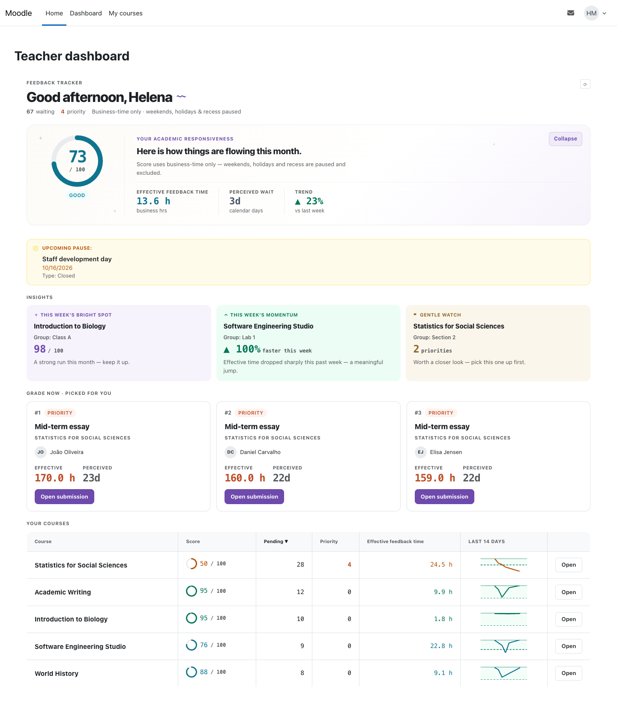
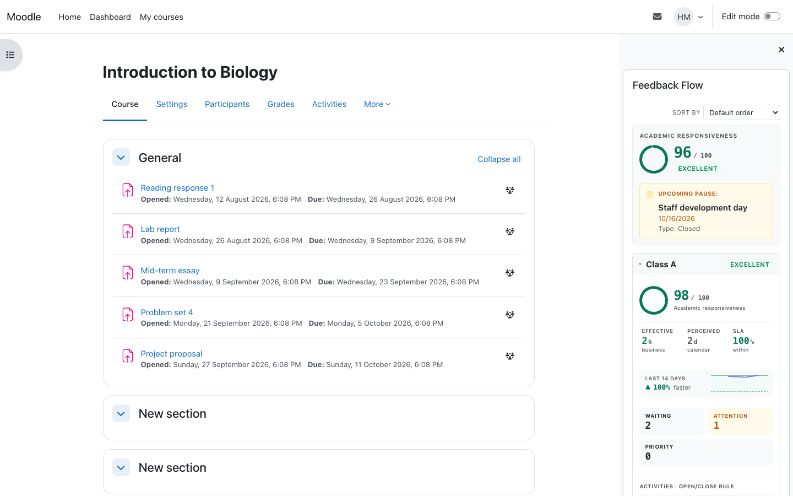
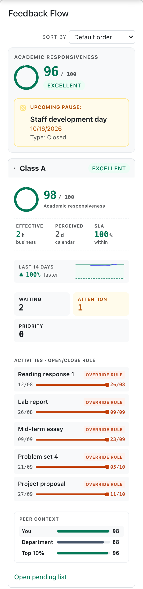
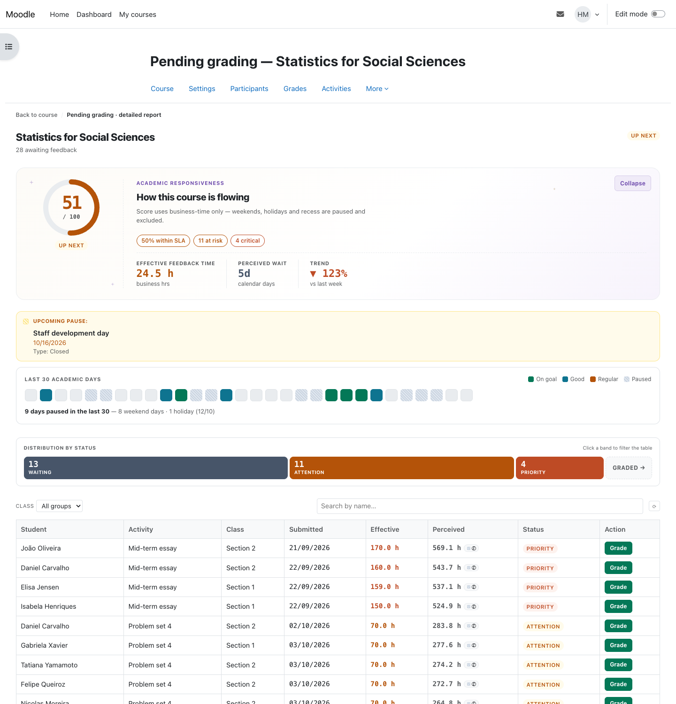

# Feedback Flow

**Feedback Flow** helps teaching teams visualize — and value — how efficiently students receive feedback on their work, measured fairly in *working time* rather than raw calendar days.

## Why Feedback Flow?

Timely feedback is one of the biggest drivers of student learning, but it is often hard to evaluate at a glance how a course is doing. Counting raw elapsed time can be misleading: it inadvertently penalizes educators for nights, weekends, holidays, and term breaks when grading is naturally paused.

Feedback Flow measures the turnaround time between a student submitting work and a teacher evaluating it using **academic business time**. It automatically pauses the clock outside of working hours, ensuring the resulting **Academic Responsiveness Score** is an encouraging indicator that rewards consistency, rather than a rigid stopwatch that adds unnecessary pressure.

## What it does

- **Academic Responsiveness Score (0–100)** for each class or group, featuring a clear status band (Excellent, Good, …) and a plain-language explanation of how the score was calculated.
- **A fair "working-time" clock** — pauses automatically on weekends, holidays, recesses, and outside configured hours, following an academic calendar you control.
- **A course block** showing each group's score, typical turnaround time, and the volume of submissions currently awaiting review.
- **A teacher dashboard** with a clean overview across all courses, a priority list for upcoming grading, and supportive insights (e.g., most improved, items requiring attention).
- **A pending-grading report** outlining what is in the queue, what has been completed, and a 30-day historical view of grading momentum.
- **Optional peer context**: each group's score beside the median of every other scored group on the site and the top 10%, with no names (shown once at least three other groups have a score).
- **Optional score simulator** — a safe sandbox to understand how different scenarios affect the score, without altering real data.

Only work that students have explicitly **submitted** triggers the system, and Feedback Flow only runs in courses where you have added the block — giving you total control over when to opt in.

## Screenshots

*Moodle with the Boost theme and a demo term: five courses, one teacher, about four hundred submissions.*

### Teacher dashboard

One page across every course the teacher teaches. The top card gives their Academic Responsiveness Score with the typical feedback time in working hours, the wait as students perceive it in calendar days, and the trend against the previous week. A pause from the academic calendar is announced a few days ahead. **Insights** name the group doing best, the one improving fastest and the one that needs a look; **Grade now** picks the three submissions that have waited longest in working time, each with a link straight to it. The course table ends in a 14-day sparkline per course.

### The block in a course

<table>
<tr>
<td valign="top" width="260"></td>
<td valign="top">

Added to a course, the block shows the course score and one card per group, read from top to bottom:

- **Course score** and its band, with any pause the academic calendar has coming up.
- **Group score** for the class.
- **Effective** feedback time in working hours, the **perceived** wait in calendar days, and the share answered within the target time (**Within target**), a reference for the indicators rather than a contractual commitment.
- **Last 14 days**: the trend, faster or slower than before.
- **Waiting, Attention, Priority**: how many submissions sit in each band of waiting time.
- **Activities**: each assignment's open and due dates for the group. A teacher who can manage overrides gets a link to give the group dates of its own.
- **Peer context**: the group's score next to the median of every group on the site and the top 10%.
- **Open pending list**: the course report below, filtered to the group.

</td>
</tr>
</table>

### Course report

The pending-grading report for one course or group. The score card adds how many submissions were answered within the goal and how many are at risk or critical; the strip of the last 30 academic days shows which days met the goal and which were paused (weekends, holidays, recesses). The status bands filter the table, which lists every submission still waiting, longest wait first, with its effective and perceived time and a **Grade** button. **Graded** switches the table to the work already answered.

## What counts as a response

The clock stops when the teacher's response is **recorded for the student**: a mark saved in the assignment, or a grade the student can see in the gradebook. For activities that use marking workflow, whether an unreleased mark already counts is an admin setting (see *What counts as pending* below). Two things follow, and both are worth knowing before you read the numbers.

**Grading in the gradebook counts.** A mark entered straight into the grader report, single view, or a grade import closes the clock just as marking inside the assignment does — the student sees it either way. Whichever came first is the one recorded, and it is never taken back: deleting the grade afterwards does not re-open a response the student already received. Rows answered this way carry a **"Graded in gradebook"** tag on the pending report, because the assignment's own grading screen shows nothing that would explain them.

**A hidden grade has not reached anybody.** If the gradebook hides the grade — the item hidden, or a *hidden until* date still in the future — the student sees no grade, no feedback, and gets no notification. So a grade entered in the gradebook while hidden does not count as a response at all.

There is one exception, and it is deliberate: **a mark made inside the assignment still stops the clock even while the gradebook hides it.** That is how the plugin has always behaved, and changing it would move figures that have already been reported. Instead those rows are flagged on the pending report with a **"Hidden from student"** tag telling you the grade still needs to be released. If your courses hold results back by hiding a column, expect to see that tag — it is pointing at real work left to do, not at an error.

## What counts as pending

A submission is **pending** — the "awaiting review" number on the block, the dashboard and the pending-grading report — when the student has **submitted** it (drafts never count), it is their **latest attempt**, and no response to that hand-in has been recorded yet: no mark saved in the assignment after the work came in, and no visible gradebook grade as described above.

- **Marking workflow.** By default a saved mark ends the wait even before it is released; the report tags such rows **"Awaiting release"**. With the admin setting *Stop the clock at release, not at marking* turned on, an unreleased mark keeps the submission pending.
- **Resubmission.** When a student changes work that was already marked (Moodle's *Graded - resubmitted*), it is pending again with a fresh clock, and the earlier response keeps its recorded time. Each hand-in is measured on its own because a revision after feedback is a new request for a response: folding it into the old one would either erase a turnaround the teacher already achieved or charge them for days the work spent with the student.
- **Timing.** The block and the dashboard show a summary the plugin refreshes in the background, so it can trail a change by a few minutes; the report lists the submissions themselves.

The assignment's own **"Needs grading"** count (its grading summary and the *Requires grading* filter) agrees on drafts, latest attempts and empty or unset grades, but the two numbers can still differ:

| Situation | Feedback Flow | Assignment "Needs grading" |
|---|---|---|
| Grade entered only in the gradebook | Answered (tagged "Graded in gradebook") | Still needs grading |
| Team assignment | One pending item per team member | Not shown on the assignment page; one per team on the course's activity overview |
| Student in several groups | Counted once, under the group joined most recently | Counted in each of their groups, filtered by the group you select |
| Submitted by someone who can grade (a teacher using *Switch role*, a TA) | Not counted, unless *Exclude grader submissions* is turned off | Counted |
| Enrolment suspended or ended | Dropped by a background sweep that runs every two hours, so it can still count for a while | Dropped at once |
| Marked, not yet released, with *Stop the clock at release* on | Pending | No longer needs grading |
| Old rows an administrator dismissed with `cli/dismiss_legacy_pending.php` | Not counted | Still needs grading |
| Scope | Every assignment in courses that have the block on the course page itself, visible courses only unless *Process hidden courses* is on | One assignment at a time |

## Requirements

- Moodle 5.2 (this branch, `MOODLE_502_STABLE`; `main` and `MOODLE_503_STABLE` are the Moodle 5.3 release, `MOODLE_501_STABLE` the 5.1 one, `MOODLE_405_STABLE` the 4.5 one)
- PHP 8.3 or later
- PostgreSQL or MariaDB, at the versions Moodle 5.2 requires (PostgreSQL 16, MariaDB 10.11); the plugin is tested on those two
- No other plugin: the block reads `mod_assign` and the gradebook, both part of core

## Installation

1. Copy the plugin into `<moodle>/blocks/feedback_tracker`.
2. Visit *Site administration → Notifications* (or run `php admin/cli/upgrade.php`) to complete the installation.
3. Review the settings under *Site administration → Plugins → Blocks → Feedback Flow* (see *Settings* below). The **Calendar behaviour** section chooses which pauses apply (weekends, holidays, recesses, business hours) and the time zone; the days, weekly hours and pause windows themselves are set in the **Calendar editor**, linked under *Tools* on the same page.

## Getting started

1. Turn editing on in a course and add the **Feedback Flow** block.
2. Teachers in that course open their dashboard from the block to see scores, priorities, and the pending-grading report.
3. (Optional) Fine-tune the academic calendar and the scoring weights in the admin settings.

## Settings

All settings live under *Site administration → Plugins → Blocks → Feedback Flow* and are stored as `block_feedback_tracker/<name>`. Changing one that the figures depend on re-queues every course's summary for recomputation.

- **Scoring**: the five score weights `weight_compliance` (0.40), `weight_median` (0.25), `weight_critical` (0.15), `weight_pending` (0.10) and `weight_trend` (0.10), rescaled at read time when their sum is not close to 1; the goal `sla_goal_hours` (24 effective hours) or `sla_goal_days` (2 business days); the waiting-time bands `bucket_thresholds_eff` (24, 48, 120 hours) or `bucket_thresholds_days` (2, 5, 10 days); and the score bands `score_thresholds_band` (90, 70, 40).
- **Calendar behaviour**: `excludeweekends`, `excludeholidays`, `excluderecesses` and `enablebusinesshours` (all on), `weekendmask` (Saturday and Sunday), `timezone` (the server's) and `grading_during_pause_mode` (clipped: time inside a pause never counts).
- **Processing scope**: `process_hidden_courses` (off), `backfill_active` (off: when on, submissions made before the block was added are measured too) and `backup_ledger` (`rederive`: see *Backup and restore*).
- **Performance**: batch sizes and time caps of the background tasks (`recompute_batch_size`, `pending_batch_size`, `drain_time_cap_seconds`, `backfill_chunk`, `backfill_chunk_per_course`, `backfill_sub_chunk`, `reconcile_batch_size`, `reconcile_time_cap_seconds`, `retention_batch_size`), the recent-statistics window `trend_window_days` (30), `purge_inactive_after_days` (730) and `retention_days` (365).
- **Views**: `enable_admin_view_all` (off), `enable_teacher_simulator` (off), `show_perceived_time`, `show_paused_today_indicator`, `show_peer_context` and `exclude_grader_submissions` (on), `release_stops_clock` (off), `reconcile_active` (on), `retention_active` (off), `removal_cleanup_active` (off), `removal_grace_follow_recyclebin` (on), `removal_grace_seconds` (7 days), `display_time_unit` (business hours) and the group card's `group_title_fields` and `group_subtitle_fields` (empty).
- **Tools**: links to the calendar editor, the recompute audit log, the bulk block removal and the data reset pages.

## Capabilities

| Capability | Context | Given by default to | What it allows |
|---|---|---|---|
| `block/feedback_tracker:addinstance` | Course | Editing teacher, manager | Add the block to a course |
| `block/feedback_tracker:myaddinstance` | Course | Authenticated user | Add the block to the Dashboard (the block offers itself on course pages only) |
| `block/feedback_tracker:viewresponsiveness` | Course | Teacher, editing teacher, manager | See the block's figures, the pending-grading report and the group drill-down of a course |
| `block/feedback_tracker:viewdashboard` | Course | Teacher, editing teacher, manager | Open the teacher dashboard and the score simulator, over the courses where the user holds it |
| `block/feedback_tracker:viewalldata` | System | Nobody | See every course and group on the teacher dashboard |
| `block/feedback_tracker:viewschoolcomparison` | System | Manager | See the site-wide benchmarks on the dashboard |
| `block/feedback_tracker:managecalendar` | System | Manager | Edit the academic calendar (days and business hours) |
| `block/feedback_tracker:managepausewindows` | System | Manager, editing teacher | Add and remove pause windows, checked in the window's own context |
| `block/feedback_tracker:resetdata` | System | Manager | Erase every measurement (the data reset) |
| `block/feedback_tracker:bulkmanageblocks` | System | Manager | Remove the block from many courses at once |
| `block/feedback_tracker:viewaudit` | System | Manager | Read the recompute audit log |

## Data stored

The plugin reads `mod_assign` submissions, grades and marker allocations and keeps what it measured in its own tables:

| Table | One row is | Personal data | Kept until |
|---|---|---|---|
| `block_feedback_tracker_sub` | One measurement cycle of a submission: course, group, activity, attempt, status, the submission, marking, release and grading times, the allocated marker and the waiting and effective time | The student (`userid`) and the allocated marker (`allocmarkerid`) | The course, the activity or the submission goes, the student is no longer an active participant of the course (checked every two hours), or the student's account is deleted. With `retention_active` on, graded rows older than `retention_days` (365 by default) are deleted every night; pending rows never are |
| `block_feedback_tracker_alloc` | One marker slot of a cycle on a multi-marking activity: position, allocation and marking times | The student (`userid`) and the marker (`marker`) | Deleted with the cycle it belongs to |
| `block_feedback_tracker_group` | The summary of one course group: counts, medians, compliance, score and band | None | The course is deleted |
| `block_feedback_tracker_trend` | One day of one course group: median time, graded count, compliance | None | The course is deleted, or the day falls outside `retention_days` with `retention_active` on |
| `block_feedback_tracker_site` | One day of the whole site: medians, percentiles, compliance | None | The day falls outside `retention_days` with `retention_active` on |
| `block_feedback_tracker_queue` | A course group waiting to be recomputed | None | Recomputed, within five minutes |
| `block_feedback_tracker_cday` | A calendar exception: holiday, recess, closure or optional day | The administrator who last edited it (`usermodified`) | Removed in the calendar editor, or its date is older than `purge_inactive_after_days` (730) |
| `block_feedback_tracker_chours` | One weekly business-hours slot | The administrator who last edited it (`usermodified`) | Replaced in the calendar editor |
| `block_feedback_tracker_cpause` | A manual pause window of the site, a course or a group | The user who last edited it (`usermodified`) | Removed in the calendar editor, or it ended more than `purge_inactive_after_days` ago |
| `block_feedback_tracker_log` | One recompute: reason, rows affected, start and end | The user who triggered it (`triggeredby`) | 90 days |
| `block_feedback_tracker_bfcursor` | How far the history backfill has read one course | None | The course is deleted |

Removing the block from a course keeps that course's rows unless `removal_cleanup_active` is on; then they are deleted after the grace period (`removal_grace_seconds`, or the recycle bin's retention). The data reset (`pages/reset.php`, `cli/reset.php`) deletes every measurement table and keeps the calendar and the audit log. The plugin also stores two user preferences, `block_feedback_tracker_dashboard_collapsed` and `block_feedback_tracker_report_collapsed` (whether the dashboard's and the report's top panels are collapsed).

Everything above is covered by the Privacy API. A data request exports, per course, the user's submission cycles, the marker slots on their work, the cycles and slots where they were the allocated marker, and, at site level, the calendar rows and recomputes they are recorded against, plus both preferences. A deletion request deletes the student's cycles and slots; for a marker it clears `allocmarkerid` and deletes the slots they held, keeping the students' rows; for the calendar and the audit log it clears the user id and keeps the row. The course summaries hold no user and are recomputed from what remains.

Opening a submission from the dashboard or the report may clear the viewer's own saved filters on the assignment's grading page (status, workflow, marker and name initial), when they would hide that student; those preferences belong to `mod_assign`.

## Backup and restore

What a course backup carries is the `backup_ledger` setting:

- **`rederive`** (default): the backup carries nothing of the plugin. Once the course is restored, an adhoc task (`rederive_course`) rebuilds its measurements in the background from the restored submissions and grades. What Moodle itself does not store cannot be rebuilt: when feedback was released, when a marker was allocated, each marker's own completion on a multi-marking activity, the cycles a resubmission superseded and the rows taken out with the legacy dismissal.
- **`full`**: backups that include user data also carry every row of `block_feedback_tracker_sub` and `block_feedback_tracker_alloc` for the course. The restore maps them to the restored activities, students, groups and markers, leaves out the rows of anything not restored, and then runs the same rebuild for whatever the file did not hold. Backups without user data, course imports among them, carry no rows.

A restore follows what the backup file holds, not the setting at the time of the restore. The block must be restored with the course for anything to be measured there.

The cost, measured on Moodle 5.3 with PostgreSQL on a course of 300 students and 10 assignments (3,000 measurement rows): `full` made the backup file 220 KiB instead of 119 KiB and added about 1.5 s to the backup (7.9 s against 6.3 s) and 1.9 s to the restore (7.7 s against 5.8 s). The rebuild runs in cron afterwards in either mode and took about 7 s.

## Translations

The English strings ship in the package. The Brazilian Portuguese translation is maintained in this repository (`lang/pt_br`) and reaches sites through [AMOS](https://lang.moodle.org/), as the plugins directory requires; it is left out of the release package.

## License

GNU GPL v3 or later.